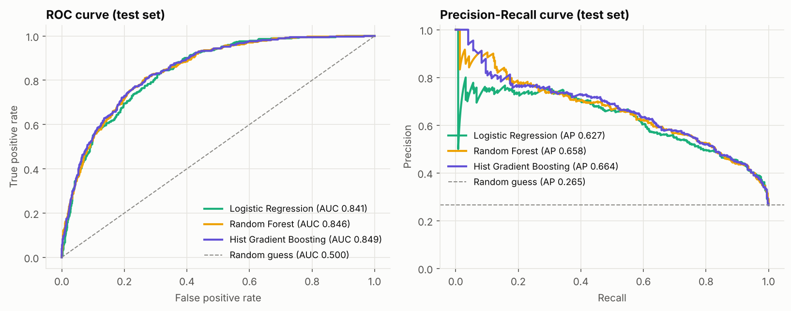
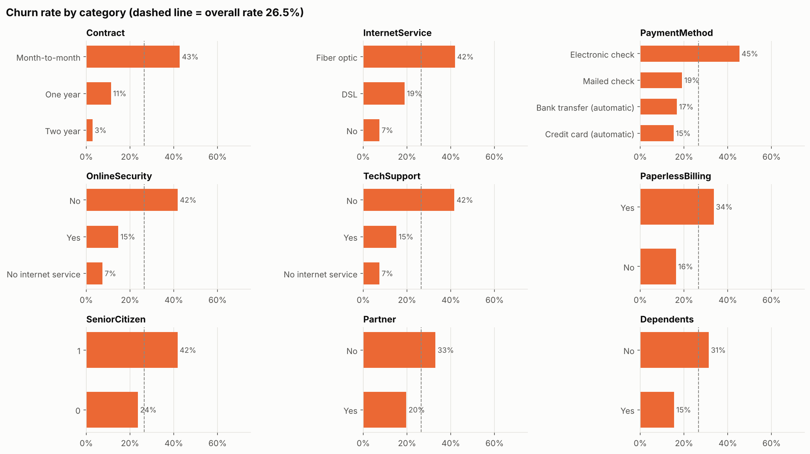
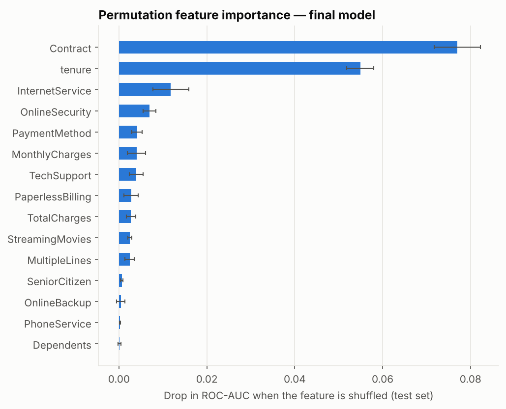

# Telco Customer Churn Prediction

End-to-end machine learning project that predicts which telecom customers are likely to cancel
their service, so a retention team can prioritize who to contact.

It covers the full workflow — data cleaning, exploratory analysis, a leakage-safe preprocessing
pipeline, hyper-parameter tuning with cross-validation, model comparison, decision-threshold tuning,
held-out evaluation, model interpretation, and a reusable prediction script.



## Results

Four models were tuned with 5-fold stratified cross-validation on the training set (80% of the data).
The final model was **selected by cross-validated ROC-AUC**, then evaluated **once** on the untouched
test set (20%, 1,409 customers).

| Model | CV ROC-AUC (mean ± std) | Test ROC-AUC | Test PR-AUC | Test Recall | Test Precision | Test F1 |
|---|---|---|---|---|---|---|
| **Hist Gradient Boosting** (selected) | **0.849 ± 0.012** | **0.849** | **0.664** | 0.805 | 0.521 | 0.632 |
| Random Forest | 0.848 ± 0.010 | 0.846 | 0.658 | 0.786 | 0.525 | 0.630 |
| Logistic Regression | 0.846 ± 0.013 | 0.841 | 0.627 | 0.783 | 0.506 | 0.615 |
| Dummy baseline (predicts class prior) | 0.500 ± 0.000 | 0.500 | 0.265 | 0.000 | 0.000 | 0.000 |

*Test recall/precision/F1 above use the default 0.5 threshold.*

**Final model — Histogram-based Gradient Boosting with a tuned decision threshold (0.57):**

| Test-set metric | Value |
|---|---|
| ROC-AUC | 0.849 |
| PR-AUC (average precision) | 0.664 (random baseline: 0.265) |
| Recall (churners caught) | 0.743 |
| Precision | 0.560 |
| F1 | 0.639 |
| Accuracy | 0.777 |
| Churners found in the 20% highest-risk customers | 51.3% |

**Honest interpretation**
- All three real models clearly beat the baseline, but they are **statistically very close**: the gaps
  between them are smaller than one cross-validation standard deviation. Gradient Boosting was chosen
  by the pre-defined rule (highest mean CV ROC-AUC); Logistic Regression would be a reasonable choice
  if simplicity and interpretability were the priority.
- The test scores are very close to the CV scores, which suggests the evaluation is not over-optimistic.
- The threshold of 0.57 was chosen to maximize F1 on *out-of-fold training predictions*. A business
  could pick a different threshold depending on the cost of a missed churner vs. an unnecessary
  retention offer (see `reports/figures/threshold_tradeoff.png`).

## Key insights



- **Contract type** is the strongest driver: month-to-month customers churn at ~43% vs ~11% (one-year)
  and ~3% (two-year).
- **Tenure** is the second most important feature: churn is concentrated in the first months.
- **Fiber-optic** internet users (~42%) and **electronic-check** payers (~45%) churn much more than others.
- Customers **without online security or tech support** churn ~42% vs ~15% with them.
- Gender and phone service have almost no relationship with churn.



## Methodology

| Step | Choice | Reason |
|---|---|---|
| Cleaning | `TotalCharges` text → numeric; 11 blanks (all `tenure == 0`) set to 0 | New customers haven't been billed yet; deterministic rule, no leakage |
| Split | Stratified 80/20, `random_state=42` | Preserves the 26.5% churn rate; test set held out until the end |
| Preprocessing | Median imputer + `StandardScaler` (numeric); most-frequent imputer + `OneHotEncoder(handle_unknown="ignore")` (categorical) | Wrapped in a `ColumnTransformer` **inside** the model `Pipeline`, so it is re-fit on every CV training fold |
| Class imbalance | `class_weight="balanced"` | Simple, no synthetic data, nothing to leak across folds |
| Models | Dummy, Logistic Regression, Random Forest, HistGradientBoosting | Baseline + linear model + two tree ensembles |
| Tuning | `GridSearchCV`, 5-fold stratified CV, scoring = ROC-AUC | Threshold-independent ranking metric suited to imbalanced data |
| Model selection | Highest mean CV ROC-AUC | The test set is never used to make decisions |
| Threshold | Maximize F1 on out-of-fold predictions (`cross_val_predict`) | Avoids tuning on the test set |
| Interpretation | Permutation importance (drop in ROC-AUC) on the test set | Model-agnostic, works on original columns |

## Project structure

```
customer-churn-prediction/
├── data/raw/                     # Original dataset (IBM Telco Customer Churn)
├── notebooks/
│   └── churn_prediction.ipynb    # Full analysis: EDA → modelling → evaluation → interpretation
├── src/
│   ├── config.py                 # Paths, random seed, feature lists
│   ├── data.py                   # Loading, cleaning, train/test split
│   ├── features.py               # Preprocessing ColumnTransformer + Pipeline builder
│   ├── models.py                 # Candidate models and hyper-parameter grids
│   ├── evaluate.py               # Metrics, threshold selection, permutation importance
│   ├── plots.py                  # Consistent, colorblind-safe plotting helpers
│   ├── train.py                  # End-to-end training script
│   └── predict.py                # Score new customers with the saved model
├── models/churn_model.joblib     # Saved pipeline + threshold (created by training)
├── reports/
│   ├── figures/                  # All EDA and evaluation plots
│   ├── metrics.json              # Final model metrics
│   ├── model_comparison.csv      # CV + test metrics for every model
│   └── feature_importance.csv
├── tests/test_pipeline.py        # Sanity tests for cleaning and the pipeline
├── requirements.txt
└── README.md
```

## How to run

```bash
# 1. Create an environment and install dependencies (Python 3.10+)
python -m venv .venv
source .venv/bin/activate          # Windows: .venv\Scripts\activate
pip install -r requirements.txt

# 2. Run the tests (~2 s)
python -m pytest -q

# 3. Train, tune, evaluate and save everything (~2-3 min on a laptop)
python -m src.train

# 4. Score customers with the saved model
python -m src.predict --input data/raw/WA_Fn-UseC_-Telco-Customer-Churn.csv --output reports/predictions.csv

# 5. Or explore the full analysis
jupyter notebook notebooks/churn_prediction.ipynb
```

All commands are run from the project root. Results are reproducible with the fixed `random_state=42`
(tested with Python 3.13, scikit-learn 1.9.1, pandas 3.0.5; other library versions may change the last
decimal places).

## Limitations and next steps

- Single public dataset with no time dimension — a production model should be validated on a
  later time period (out-of-time validation) to check for drift.
- Probabilities from class-weighted models are not calibrated; if exact churn probabilities are
  needed (e.g. for expected-revenue calculations), add `CalibratedClassifierCV`.
- Possible improvements: cost-based threshold selection using real retention costs, feature
  engineering (e.g. number of add-on services), SHAP explanations for individual customers, and
  serving the model through a small API.

## Dataset

[IBM Telco Customer Churn](https://www.kaggle.com/datasets/blastchar/telco-customer-churn) —
7,043 customers, 21 columns (demographics, account information, subscribed services, and the
`Churn` label).
